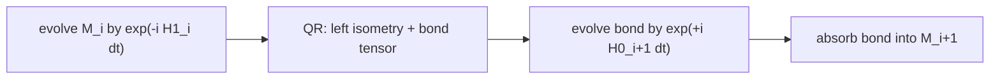

# TDVP

Alice's TDVP algorithm evolves an MPS in real time under a Hamiltonian MPO,
`|ψ(t)⟩ = exp(-i H t) |ψ(0)⟩`, by projecting the Schrödinger equation onto the
tangent space of the MPS manifold at the current state.

## API

| Symbol | Description |
|--------|-------------|
| [Options](options.md) | Run options: scheme, time step, step count, integrator order, bond dimension, caching, artifacts |
| [Summary](summary.md) | Evolution history: times, energies, norms, bond dimensions, discarded weights |
| [Artifact](artifact.md) | State snapshot at one time step |
| [run](run.md) | Top-level entry point |

## Usage Pattern

```python
from alice.network import build_interaction, build_hamiltonian, init_mps
from alice.algorithm import tdvp

interactions, spc, geo = build_interaction(cfg)
H = build_hamiltonian(interactions, geo.L, spc)

state = init_mps(geo.L, spc, ops, bond_dim=1, config=[1, 0, 1, 0])

opts = tdvp.Options(scheme='2s', dt=0.05, n_steps=40, max_bond=64)
summary, artifact = tdvp.run(tdvp.Artifact(state=state, time=0.0, step=0), H, opts)

for t, e in zip(summary.times, summary.energies):
    print(f"t = {t:.4f},  E = {e:.10f}")
```

`run()` takes the initial state as an `Artifact` (`state`, `time`, `step`) and
the Hamiltonian MPO as a separate argument — unlike XTRG, where the generator
is baked into the density matrix being squared.

A real-valued input MPS is promoted to `complex128` in place, logged at INFO.
Evolution is unitary, so there is nothing to gain from a real state and nothing
correct to be had from one.

### Resuming and continuing

Resuming an interrupted run is calling `run()` again with the `Artifact` loaded
from `tdvp.ckpt`; the time and energy history is recovered from
`evolution.ckpt` automatically:

```python
resumed = tdvp.Artifact.load(ckpt_dir / 'tdvp.ckpt')
summary, artifact = tdvp.run(resumed, H, opts)
```

A finished run continues from any archived `artifacts/step_XXXXX.ckpt` with new
options — here evolving from `t = 2.0` out to `t = 5.0` at a larger bond
dimension:

```python
state = tdvp.Artifact.load(ckpt_dir / 'artifacts' / 'step_00040.ckpt')
opts = tdvp.Options(dt=0.05, n_steps=100, max_bond=256,
                    checkpoint_dir=str(ckpt_dir))
summary, artifact = tdvp.run(state, H, opts)
```

`n_steps` is the absolute step index to stop at, counted from `t = 0`, not a
number of additional steps, and `dt` must match the step the recovered history
was built on. Starting from a step *before* the end of the history truncates it
back to that step (with a warning) and recomputes forward, overwriting both
`evolution.ckpt` and the affected `step_XXXXX.ckpt` archives.

Not every step has to be archived. `save_artifacts_every` sets the stride, and
because it is keyed on the absolute step index, a resumed run writes the same
grid as an uninterrupted one. A run also stops on a grid point rather than
between two, so its final state is always among the snapshots; see
[Artifact](artifact.md).

## Update Schemes

| Name | Alias | Description |
|------|-------|-------------|
| `'1s'` | `'1-site'`, `'one-site'` | 1-site update; **cannot** change bond dimension |
| `'2s'` | `'2-site'`, `'two-site'` | 2-site update with SVD truncation; grows bonds as entanglement develops |

`'1sp'` is accepted by `Options` for forward compatibility but rejected by
`run()` with `NotImplementedError`.

!!! warning "The 1-site scheme cannot grow bonds"

    This is a sharper restriction than the corresponding one in DMRG or XTRG,
    where a 1-site run merely converges less well. The 1-site TDVP manifold is
    one of *fixed* bond dimension, so a quench started from a product state —
    every bond of dimension 1 — stays a product state forever, while norm and
    energy remain conserved to machine precision and the run looks healthy.

    `run()` detects this and warns at startup, naming the offending bonds:

    ```text
    scheme '1s' cannot grow bond dimensions, and bond(s) 0, 4 have dimension
    1; no correlation can cross them, so the dynamics there will be frozen
    while norm and energy stay conserved. Use scheme '2s', or warm up with
    '2s' until every bond has opened.
    ```

    Start from a state whose bonds are already open, or use `'2s'` (the
    default).

## Integrator Order

| `order` | Sweep structure |
|---------|-----------------|
| `1` | a single half-sweep at `dt`, alternating direction between steps (Lie-Trotter) |
| `2` | a forward half-sweep at `dt/2` then a backward one, leaving the center back at site 0 (Lubich symmetric) |

Both are globally second order at equal cost, because `run()` alternates the
direction for `order=1`: two consecutive `order=1` steps of size `dt` are
*exactly* one `order=2` step of size `2dt` — the same local exponentials in the
same sequence, verified to 1e-9.

The difference is where the snapshots land. Every `order=2` step ends at a
symmetric point, whereas an `order=1` snapshot taken after an odd step carries
first-order error. If observables are measured at every step rather than only
at the end, prefer `order=2`.

Note that error scaling in `dt` is only observable on a *restricted* manifold.
At full bond dimension the tangent-space projector is the identity, TDVP is
exact at any step size, and halving `dt` changes nothing.

## The Tangent-Space Projection

TDVP replaces `d|ψ⟩/dt = -i H |ψ⟩` with its projection onto the tangent space
of the manifold of MPS at fixed bond dimension:

\[
P_{T_\psi} = \sum_n P^{L}_{<n} \otimes \mathbb{1}_n \otimes P^{R}_{>n}
           - \sum_n P^{L}_{\leq n} \otimes P^{R}_{>n}
\]

The algorithm never forms this operator. The first sum is the sequence of
single-site evolutions over the sweep, each of which *is* the projection onto
one of its terms: the left and right environments built from canonical
neighbors are exactly `P^L` and `P^R`, so `exp(-i H_eff dt)` acting on one site
tensor moves the state only within that term's image.

The second sum, with its minus sign, is the zero-site **back-evolution** on
each bond, applied with `-dt`. It removes the double counting between
consecutive terms of the first sum. Omitting it does not merely degrade
accuracy — it breaks even first-order consistency.



One full sweep is one time step. There is no inner convergence loop and no
`e_tol` analogue: TDVP integrates, it does not optimize.

## Local Exponentials

Each local update exponentiates an effective Hamiltonian against one tensor
with a Lanczos–Krylov method (`krylov.py`), using full re-orthogonalization and
exponentiating the Lanczos tridiagonal exactly via `numpy.linalg.eigh`. It
terminates on happy breakdown or when the last Krylov coefficient falls below
`krylov_tol`; `Summary.krylov_errors` records the per-step maximum of that
estimate, and a run whose values sit near `krylov_tol` wants a larger
`krylov_dim`.

## Conserved Quantities

Energy and norm are conserved exactly by the projected flow, which makes them
diagnostics of numerical health rather than of physical accuracy — a run that
has truncated away the real physics still conserves both. Trust them to detect
a broken integrator, not a converged answer. The quantities to converge in
`max_bond` are the observables themselves.

`renormalize` defaults to `False` so that norm loss from truncation stays
visible in `Summary.norms`.

## See Also

- [tdvp.run](run.md) — full parameter reference.
- [MPS](../../api/network/mps.md) — the state representation.
- [init_mps](../../api/network/init-mps.md) — building the initial state, including its `dtype` keyword.
- [Examples](../../examples/index.md#tdvp) — four validated walkthroughs against analytic references.
